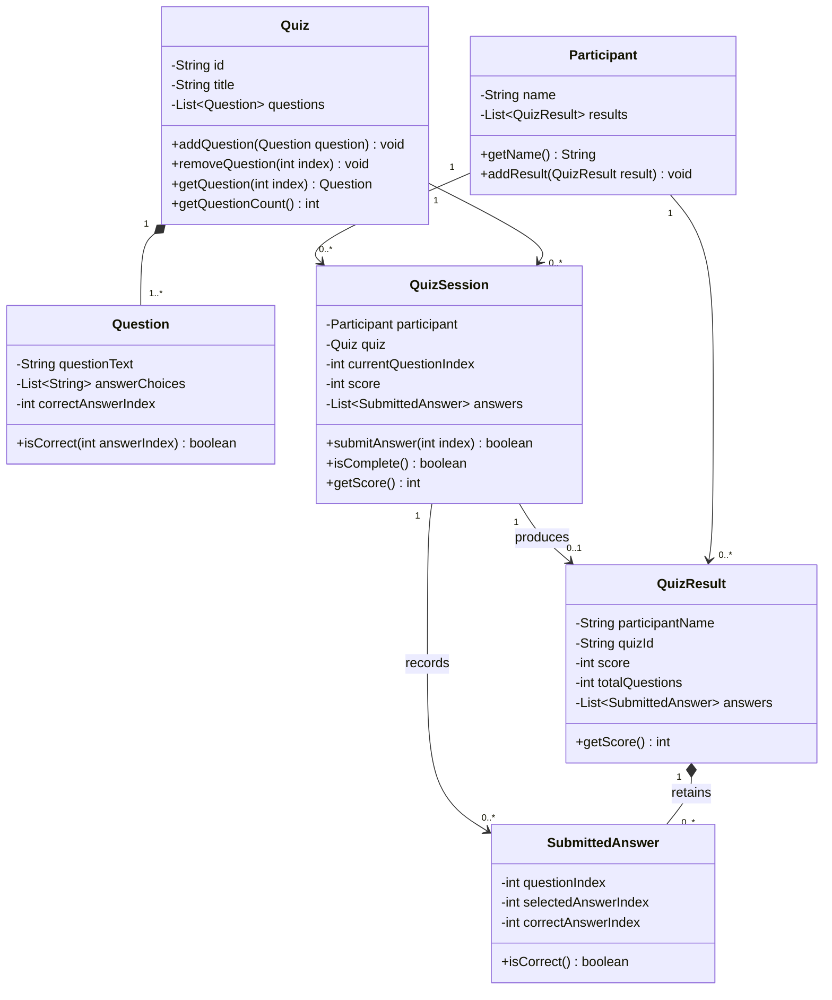
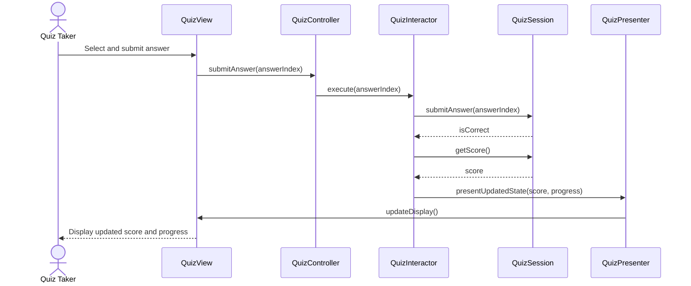
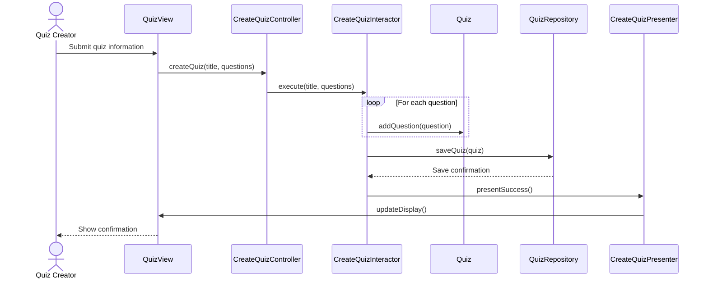
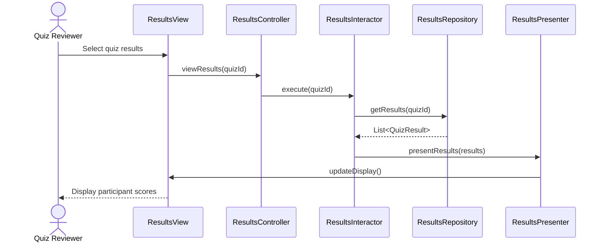
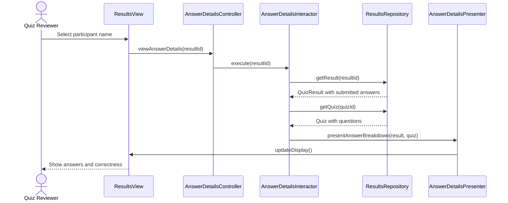

# Trivia Quiz Program

## Team Information

### Team Members
- Edison Liao
- Eric Zhu
- Simon Kim
- Tokhtar Yessergepov

---

## Trivia Quiz Program

### Domain

The Trivia Quiz Program is an interactive application in which users can create, customize, save, and take multiple-choice trivia quizzes. Quiz takers enter their names, answer questions, monitor their progress and score, and view their final results. Quiz creators can write and edit questions, preview their quizzes, and save them for later use. Quiz reviewers can view participants' results for a selected quiz. The application aims to make trivia accessible, engaging, and easy to manage.

---

## User Stories

### Quiz Taker
1. As a quiz taker, I want to enter my name so that I can compete against other people.
2. As a quiz taker, I want to answer trivia questions through a clean and interactive interface so I can test my knowledge in a fun, low-stakes environment.
3. As a quiz taker, I want to see a progress bar so I know how many questions are left.
4. As a quiz taker, I want to see my score so I know how well I am doing.

### Quiz Creator
5. As a quiz creator, I want to use a form to create and edit trivia questions so I can build custom quizzes.
6. As a quiz creator, I want to be able to preview my quiz so I can ensure a good experience for my audience.
7. As a quiz creator, I want to save my questions and quizzes so that I can use them later.
8. As a quiz creator, I want to generate a quiz from an online trivia database by choosing a category, difficulty, and number of questions, so I can make a quiz quickly without writing every question myself.

### Quiz Reviewer
9. As a quiz reviewer, I want to view a summary screen showing each participant's score after they complete the quiz.
10. As a quiz reviewer, I want to click on a participant’s name to see a detailed breakdown of their answers and which ones were correct.
11. As a quiz reviewer, I want to view a summary screen showing each participant's score after they complete the quiz.

---

## Use Cases

### Use Case 1: Take Trivia Quiz

**Primary actor:** Quiz Taker

**Preconditions:**
- The quiz taker has entered a name.
- The quiz taker has selected an available quiz containing at least one question.

**Trigger:** The quiz taker chooses to start the selected quiz.

**Success outcome:** All questions have been answered, the final score is displayed, and the result is recorded.

**Main success scenario:**
1. The quiz taker starts the selected quiz.
2. The system displays the first question and its possible answers.
3. The quiz taker selects and submits an answer.
4. The system checks the answer and updates the score.
5. The system updates the progress indicator and, if questions remain, displays the next question.
6. Steps 3–5 repeat until all questions have been answered.
7. The system displays the final score.
8. The system records the quiz result.

**Extensions:**
- **3a. No answer is selected:** The system requests a selection and keeps the current question visible; the quiz taker can retry.
- **4a. The answer is incorrect:** The score does not increase; the quiz continues.
- **8a. Results cannot be recorded:** The system reports the failure and keeps the final score visible.

### Use Case 2: Create and Edit Trivia Quiz

**Primary actor:** Quiz Creator

**Preconditions:** The quiz creator has access to the quiz creation or editing feature.

**Trigger:** The creator chooses to create a new quiz or edit an existing quiz.

**Success outcome:** A valid quiz is created or updated and is available for saving.

**Main success scenario:**
1. The creator requests to create or edit a quiz.
2. The system displays the quiz's current information or an empty quiz form.
3. The creator enters or updates the quiz title.
4. The creator enters a question and its possible answers.
5. The creator identifies the correct answer.
6. The system validates the question information.
7. The creator repeats steps 4–6 as needed.
8. The creator confirms the changes.
9. The system makes the created or updated quiz available for saving.

**Extensions:**
- **6a. Required question information is missing:** The system identifies the problem and allows the creator to correct it.
- **7a. The creator edits an existing question:** The system displays the question's information, accepts revisions, and validates them.
- **8a. The quiz contains no questions:** The system asks the creator to add at least one question before confirming.

### Use Case 3: Generate Quiz from Online Trivia Database

**Primary actor:** Quiz Creator

**Preconditions:** The application has an internet connection.

**Trigger:** The creator chooses to generate a quiz from the online trivia database.

**Success outcome:** A new quiz made of questions from the online database is saved and available to quiz takers.

**Main success scenario:**
1. The creator requests to generate a quiz.
2. The system displays the trivia categories available from the online database.
3. The creator selects a category, a difficulty, and the number of questions, and enters a quiz title.
4. The system retrieves matching questions from the online database and creates the quiz.
5. The system displays the generated questions.
6. The creator confirms the quiz.
7. The system saves the quiz and confirms it was saved.

**Extensions:**
- **2a. The online database cannot be reached:** The system reports that it cannot connect and returns to the main menu; no quiz is created.
- **4a. Not enough questions are available for the selected options:** The system reports how many are available and lets the creator continue with fewer questions or change the options.
- **6a. The creator discards the quiz:** The generated quiz is not saved.

### Use Case 4: View Quiz Results

**Primary actor:** Quiz Reviewer

**Preconditions:** At least one completed quiz result has been recorded.

**Trigger:** The reviewer requests to view results.

**Success outcome:** The reviewer sees participants' names and scores for the selected quiz.

**Main success scenario:**
1. The reviewer opens the results feature.
2. The system displays quizzes with recorded results.
3. The reviewer selects a quiz.
4. The system retrieves the associated results.
5. The system displays each participant's name, score, and total number of questions.
6. The reviewer compares participants' performances.

**Extensions:**
- **4a. No results for the selected quiz:** The system explains that no results are available and allows another selection.
- **4b. Results cannot be retrieved:** The system displays an error and offers a retry.

### Use Case 5: View Participant Answer Breakdown

**Primary actor:** Quiz Reviewer

**Preconditions:** The reviewer is viewing results for a quiz, and at least one participant has a recorded result with individual answers.

**Trigger:** The reviewer selects a participant's name from the results summary.

**Success outcome:** The reviewer sees each question, the participant's submitted answer, the correct answer, and whether the submission was correct.

**Main success scenario:**
1. The reviewer selects a participant's name from the results summary.
2. The system retrieves that participant's recorded answers for the selected quiz attempt.
3. The system displays each question alongside the participant's answer and the correct answer.
4. The system indicates which answers were correct and which were incorrect.
5. The reviewer examines the breakdown and can return to the results summary.

**Extensions:**
- **2a. Answer details are unavailable:** The system explains that the detailed breakdown is unavailable while retaining the participant's summary score.
- **2b. Details cannot be retrieved:** The system displays an error and allows the reviewer to retry or return to the summary.

---

## Minimal Viable Product (MVP)

The MVP focuses on the four original core use cases. The participant answer breakdown (Use Case 5) extends results review and can be integrated with that feature. The following responsibilities are proposed and should be confirmed by the team.

| Team Member | MVP Use Case |
|-------------|--------------|
| Edison Liao | Create and Edit Trivia Quiz |
| Eric Zhu | Take Trivia Quiz |
| Simon Kim | Generate Quiz from Online Trivia Database |
| Tokhtar Yessergepov | View Quiz Results |

Saving and loading quizzes and results is shared data-access code used by all use cases and will be agreed on by the whole team.
Name entry, progress indicators, quiz preview, and interface refinements support these primary use cases and may be developed as integrated features.

---

## Entities

### Entity 1: Participant
- **Attributes:** `name: String`, `results: List<QuizResult>`
- **Responsibilities:** Store participant identity and associate completed results with the participant.

### Entity 2: Question
- **Attributes:** `questionText: String`, `answerChoices: List<String>`, `correctAnswerIndex: int`
- **Responsibilities:** Store the question and determine whether a submitted answer is correct.

### Entity 3: Quiz
- **Attributes:** `id: String`, `title: String`, `questions: List<Question>`
- **Responsibilities:** Manage questions and provide access to quiz content.

### Entity 4: QuizSession
- **Attributes:** `participant: Participant`, `quiz: Quiz`, `currentQuestionIndex: int`, `score: int`, `answers: List<SubmittedAnswer>`
- **Responsibilities:** Track an active attempt, evaluate submitted answers, update score and progress, and determine completion.

### Entity 5: QuizResult
- **Attributes:** `participantName: String`, `quizId: String`, `score: int`, `totalQuestions: int`, `answers: List<SubmittedAnswer>`
- **Responsibilities:** Represent the outcome of a completed quiz, including its per-question answers, for display and storage.

### Entity 6: SubmittedAnswer
- **Attributes:** `questionIndex: int`, `selectedAnswerIndex: int`, `correctAnswerIndex: int`
- **Responsibilities:** Preserve a participant’s answer to a particular question and determine whether it was correct. The corresponding question text and answer choices can be retrieved from the saved quiz.

---

## API Usage

**API Name:** Open Trivia Database (OpenTDB)

**Documentation:** https://opentdb.com/api_config.php

**Used by:** Use Case 3 (Generate Quiz from Online Trivia Database)

**How it is used in the program:**

The quiz creator can generate a quiz by choosing a category, a difficulty, and a number of questions. The application uses three OpenTDB endpoints:

| Purpose | Endpoint |
|---|---|
| Get the list of categories to show the quiz creator | `https://opentdb.com/api_category.php` |
| Get multiple-choice questions matching the creator's choices | `https://opentdb.com/api.php?amount=10&category=9&difficulty=easy&type=multiple` |
| Get a session token so repeated generations do not return duplicate questions | `https://opentdb.com/api_token.php?command=request` |

**Handling the response:**

- Each result contains a question, one correct answer, and three incorrect answers. These are converted into the application's own `Question` entities by an adapter class, so no other part of the application depends on the API's data format.
- The `response_code` field is checked to detect problems, such as too few questions being available for the selected options (Use Case 3, extension 4a).
- Question text is returned HTML-encoded (for example `&quot;`), so it is decoded before being shown to the user.

**Constraints:**

- No API key is required.
- OpenTDB allows one request every 5 seconds per IP address, so the application makes one question request per generated quiz.
- An internet connection is required only for generating quizzes. Saved quizzes and results remain available offline.
---
## Design Diagrams

These diagrams are **proposed designs**, not a claim about already implemented Java classes. In keeping with Chapter 8, the class diagram shows structure, while each sequence diagram traces a specific scenario through object interactions. The use cases above intentionally avoid prescribing implementation details.

### UML Class Diagram

### Sequence Diagram 1: Take Trivia Quiz

### Sequence Diagram 2: Create and Save Trivia Quiz

### Sequence Diagram 3: View Quiz Results

### Sequence Diagram 4: View Participant Answer Breakdown

---

## How to Run

*To be finalized once the application is implemented.*

1. Clone the team's GitHub repository.
2. Open the Java project in IntelliJ IDEA.
3. Configure the required JDK and project dependencies.
4. Run the application's main class.
5. Use the interface to create or load quizzes, take a quiz, and review results.

Internet access may be required for optional OpenTDB question retrieval; locally saved quizzes should be usable offline.

---

## Notes

- **Architecture:** The team plans to follow Clean Architecture by separating entities, use-case interactors, controllers, presenters, and infrastructure.
- **Persistence:** Local JSON storage is a proposed option for quizzes and results; the exact implementation remains to be decided.
- **Testing:** Unit tests should cover answer checking, score updates, quiz validation, and result retrieval. Use-case tests should also cover the documented extensions and failures.
- **Possible extensions:** Timed questions, difficulty levels, randomized question order, leaderboard rankings, and API-based question import.
- **Open decisions:** Confirm team responsibilities, final storage format, interface technology, and which optional features fit the project timeline.
