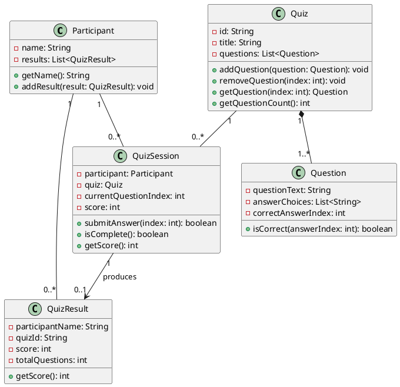
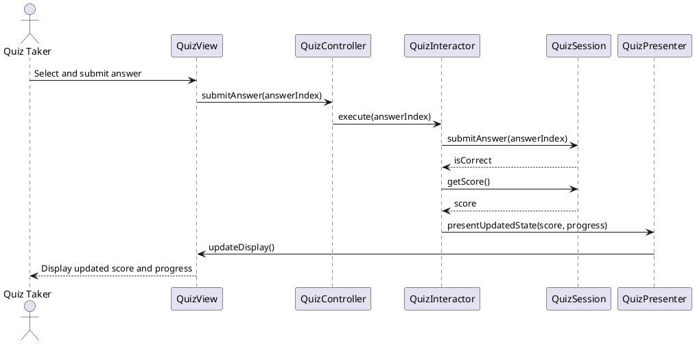
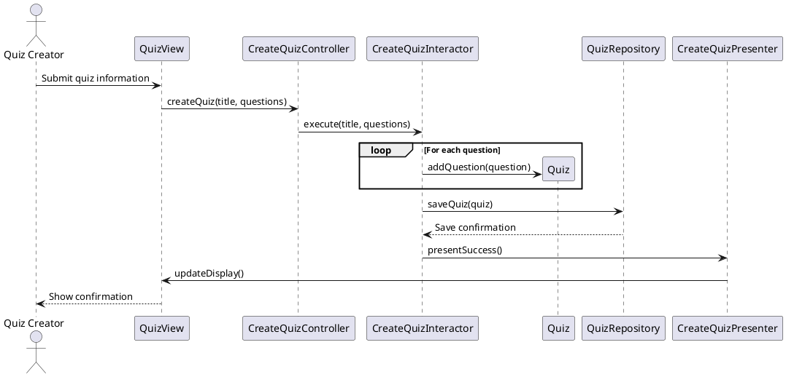
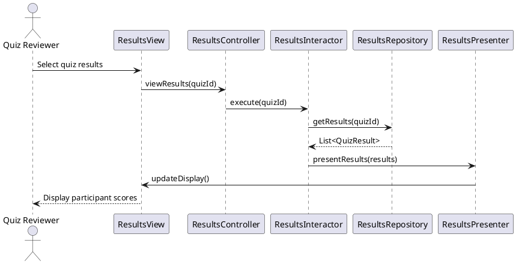

# Trivia Quiz Program

## Team Information

### Team Members
- Edison Liao
- Eric Zhu
- Simon Kim
- Tokhtar Yessergepov

---

## Trivia Quiz Program

### Domain

The Trivia Quiz Program is an interactive application in which users can create, customize, save, and take multiple-choice trivia quizzes. Quiz takers enter their names, answer questions, monitor their progress and score, and view their final results. Quiz creators can write and edit questions, preview their quizzes, and save them for later use. Quiz reviewers can view participants' results for a selected quiz. The application aims to make trivia accessible, engaging, and easy to manage.

---

## User Stories

### Quiz Taker
1. As a quiz taker, I want to enter my name so that I can compete against other people.
2. As a quiz taker, I want to answer trivia questions through a clean and interactive interface so I can test my knowledge in a fun, low-stakes environment.
3. As a quiz taker, I want to see a progress bar so I know how many questions are left.
4. As a quiz taker, I want to see my score so I know how well I am doing.

### Quiz Creator
5. As a quiz creator, I want to use a form to create and edit trivia questions so I can build custom quizzes.
6. As a quiz creator, I want to be able to preview my quiz so I can ensure a good experience for my audience.
7. As a quiz creator, I want to save my questions and quizzes so that I can use them later.

### Quiz Reviewer
8. As a quiz reviewer, I want to view a summary screen showing each participant's score after they complete the quiz.

---

## Use Cases

### Use Case 1: Take Trivia Quiz

**Primary actor:** Quiz Taker

**Preconditions:**
- The quiz taker has entered a name.
- The quiz taker has selected an available quiz containing at least one question.

**Trigger:** The quiz taker chooses to start the selected quiz.

**Success outcome:** All questions have been answered, the final score is displayed, and the result is recorded.

**Main success scenario:**
1. The quiz taker starts the selected quiz.
2. The system displays the first question and its possible answers.
3. The quiz taker selects and submits an answer.
4. The system checks the answer and updates the score.
5. The system updates the progress indicator and, if questions remain, displays the next question.
6. Steps 3–5 repeat until all questions have been answered.
7. The system displays the final score.
8. The system records the quiz result.

**Extensions:**
- **3a. No answer is selected:** The system requests a selection and keeps the current question visible; the quiz taker can retry.
- **4a. The answer is incorrect:** The score does not increase; the quiz continues.
- **8a. Results cannot be recorded:** The system reports the failure and keeps the final score visible.

### Use Case 2: Create and Edit Trivia Quiz

**Primary actor:** Quiz Creator

**Preconditions:** The quiz creator has access to the quiz creation or editing feature.

**Trigger:** The creator chooses to create a new quiz or edit an existing quiz.

**Success outcome:** A valid quiz is created or updated and is available for saving.

**Main success scenario:**
1. The creator requests to create or edit a quiz.
2. The system displays the quiz's current information or an empty quiz form.
3. The creator enters or updates the quiz title.
4. The creator enters a question and its possible answers.
5. The creator identifies the correct answer.
6. The system validates the question information.
7. The creator repeats steps 4–6 as needed.
8. The creator confirms the changes.
9. The system makes the created or updated quiz available for saving.

**Extensions:**
- **6a. Required question information is missing:** The system identifies the problem and allows the creator to correct it.
- **7a. The creator edits an existing question:** The system displays the question's information, accepts revisions, and validates them.
- **8a. The quiz contains no questions:** The system asks the creator to add at least one question before confirming.

### Use Case 3: Save and Load Trivia Quiz

**Primary actor:** Quiz Creator

**Preconditions:** The creator can access the application's quiz storage; saving additionally requires a selected quiz.

**Trigger:** The creator requests to save a quiz or retrieve a saved quiz.

**Success outcome:** The quiz is saved for future use or a previously saved quiz is retrieved.

**Main success scenario — Save:**
1. The creator requests to save a selected quiz.
2. The system validates the quiz.
3. The system stores the quiz and its questions.
4. The system confirms that the quiz was saved.

**Main success scenario — Load:**
1. The creator requests to view saved quizzes.
2. The system displays the available quizzes.
3. The creator selects a quiz.
4. The system retrieves the selected quiz.
5. The system displays it for viewing or editing.

**Extensions:**
- **Save 2a. Invalid quiz:** The system identifies the validation errors and allows corrections.
- **Save 3a. Storage failure:** The system reports that saving failed; the current quiz remains available in the session.
- **Load 2a. No saved quizzes:** The system informs the creator that none are available.
- **Load 4a. Retrieval failure:** The system reports the error and allows another selection.

### Use Case 4: View Quiz Results

**Primary actor:** Quiz Reviewer

**Preconditions:** At least one completed quiz result has been recorded.

**Trigger:** The reviewer requests to view results.

**Success outcome:** The reviewer sees participants' names and scores for the selected quiz.

**Main success scenario:**
1. The reviewer opens the results feature.
2. The system displays quizzes with recorded results.
3. The reviewer selects a quiz.
4. The system retrieves the associated results.
5. The system displays each participant's name, score, and total number of questions.
6. The reviewer compares participants' performances.

**Extensions:**
- **4a. No results for the selected quiz:** The system explains that no results are available and allows another selection.
- **4b. Results cannot be retrieved:** The system displays an error and offers a retry.

---

## Minimal Viable Product (MVP)

The MVP focuses on the four core use cases. The following responsibilities are proposed and should be confirmed by the team.

| Team Member | MVP Use Case |
|-------------|--------------|
| Edison Liao | Create and Edit Trivia Quiz |
| Eric Zhu | Take Trivia Quiz |
| Simon Kim | Save and Load Trivia Quiz |
| Tokhtar Yessergepov | View Quiz Results |

Name entry, progress indicators, quiz preview, and interface refinements support these primary use cases and may be developed as integrated features.

---

## Entities

### Entity 1: Participant
- **Attributes:** `name: String`, `results: List<QuizResult>`
- **Responsibilities:** Store participant identity and associate completed results with the participant.

### Entity 2: Question
- **Attributes:** `questionText: String`, `answerChoices: List<String>`, `correctAnswerIndex: int`
- **Responsibilities:** Store the question and determine whether a submitted answer is correct.

### Entity 3: Quiz
- **Attributes:** `id: String`, `title: String`, `questions: List<Question>`
- **Responsibilities:** Manage questions and provide access to quiz content.

### Entity 4: QuizSession
- **Attributes:** `participant: Participant`, `quiz: Quiz`, `currentQuestionIndex: int`, `score: int`
- **Responsibilities:** Track an active attempt, evaluate submitted answers, update score and progress, and determine completion.

### Entity 5: QuizResult
- **Attributes:** `participantName: String`, `quizId: String`, `score: int`, `totalQuestions: int`
- **Responsibilities:** Represent the outcome of a completed quiz for display and storage.

---

## API Usage

**API Name:** Open Trivia Database (OpenTDB)

**Documentation:** https://opentdb.com/api_config.php

**How it is used in the program:** The API is a proposed optional source of multiple-choice trivia questions. For example, `https://opentdb.com/api.php?amount=10&type=multiple` requests ten multiple-choice questions. The application can convert API responses into `Question` objects. Manual quiz creation remains supported, and the core MVP need not depend on internet access.

---

## Design Diagrams

### UML Class Diagram

### Sequence Diagram 1: Take Trivia Quiz

### Sequence Diagram 2: Create and Save Trivia Quiz

### Sequence Diagram 3: View Quiz Results

**Design validation:** Before implementation, the team should ensure that every sequence-diagram method exists on the receiving class or interface. The entity class diagram shows only domain classes; controllers, interactors, presenters, and repository interfaces can be added to a more complete architecture diagram later.

---

## How to Run

*To be finalized once the application is implemented.*

1. Clone the team's GitHub repository.
2. Open the Java project in IntelliJ IDEA.
3. Configure the required JDK and project dependencies.
4. Run the application's main class.
5. Use the interface to create or load quizzes, take a quiz, and review results.

Internet access may be required for optional OpenTDB question retrieval; locally saved quizzes should be usable offline.

---

## Notes

- **Architecture:** The team plans to follow Clean Architecture by separating entities, use-case interactors, controllers, presenters, and infrastructure.
- **Persistence:** Local JSON storage is a proposed option for quizzes and results; the exact implementation remains to be decided.
- **Testing:** Unit tests should cover answer checking, score updates, quiz validation, and result retrieval. Use-case tests should also cover the documented extensions and failures.
- **Possible extensions:** Timed questions, difficulty levels, randomized question order, leaderboard rankings, and API-based question import.
- **Open decisions:** Confirm team responsibilities, final storage format, interface technology, and which optional features fit the project timeline.
